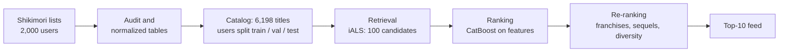

# Shikimori anime recommender


-2E7D32)


A personal anime feed for [Shikimori](https://shikimori.one) users: give it the titles someone has finished, get back the next ten worth watching.

It is also a learning project that walks through a real recommender pipeline end to end — data audit, an offline evaluation protocol, candidate retrieval, ranking, re-ranking and serving — and checks every step with numbers rather than intuition.

## Results

Offline, on 173 held-out users the models never saw during training. For each of them 20% of finished titles are hidden; the question is whether the model brings them back.

| Model | Recall@100 (retrieval) | NDCG@10 | Catalog coverage@10 |
| --- | --- | ---: | ---: |
| Popularity | 0.384 [0.350–0.418] | 0.314 | 1% |
| Item-kNN (co-watching) | 0.478 [0.444–0.511] | 0.426 | 3% |
| PureSVD, k=64 | 0.618 [0.587–0.648] | 0.616 | 7% |
| **iALS, 128 factors** | **0.647 [0.613–0.679]** | 0.598 | 8% |

Brackets are 95% bootstrap intervals over users. Every gap in Recall@100 between neighbouring rows is significant in a paired bootstrap. iALS is the current retrieval model; ranking and re-ranking are in progress.

## What the data taught us

- **A zero score is not a dislike.** 67% of list entries have `score = 0`: people simply don't rate. The positive label is "finished the title", and ratings are kept as a separate signal.
- **Timestamps can't be trusted as viewing dates.** Lists are often filled in bulk. On 122k prequel–sequel pairs the sequel was added *before* the prequel 15% of the time, and within the same minute 41% of the time. So there is no time-based split; users are split into train / validation / test groups instead.
- **Popularity is a strong baseline and a bad feed.** It finds something relevant for 80% of users, but shows everyone the same ~60 titles.
- **A few heavy users would dominate the model.** The top 1% of users produce 35% of all co-watched pairs, so every user's influence is down-weighted by the size of their list.
- **Leakage is easy to miss.** When the retrieval model has seen a user's hidden titles, Recall@100 jumps from 0.577 to 0.664. The ranking dataset is therefore built with a 5-fold split over users, and each fold is scored by a model trained without it.

## How it works



- **Catalog.** TV series, films, OVA/ONA and specials with at least 5 completions among training users. Music videos, ads and promos are excluded.
- **Retrieval** narrows 6,198 titles to 100 candidates per user. Its metric is Recall@100.
- **Ranking** reorders those 100 with features of the title, the user and the pair (genre match, popularity, whether the prequel is finished). Its metric is NDCG@10.
- **Re-ranking** applies product rules: no sequel before its prequel, a cap on titles from one franchise, more variety.
- **Serving** loads exported model files and builds a feed for any history without retraining.

## Data

A snapshot of 2,000 active Shikimori users collected on 2026-09-24 with a modified version of [kdduha/shikimori-parse](https://github.com/kdduha/shikimori-parse): 694,673 list entries, 1.7M list events, 21k favourites, and a catalog of 30,133 titles with genres, studios and franchise links. The data is not published: it contains site user IDs and needs a privacy review first. The schema is in [docs/dataset_design.md](docs/dataset_design.md).

## Quick start

```bash
uv sync                                                    # installs the package and all groups
uv run python -m shikimori_rec.ingestion.build_dataset     # raw snapshots in data/raw -> normalized tables
uv run python -m shikimori_rec.interactions.prepare        # catalog, labels, user split
uv run python -m shikimori_rec.retrieval.als               # compare retrieval models on validation
uv run python -m shikimori_rec.pipelines.export_models     # train the final iALS, save to models/
```

```python
from shikimori_rec.serving.recommender import Recommender

feed = Recommender.load().recommend(history=[1, 205, 30, 47, 43], k=5)
for item in feed:
    print(item.russian or item.name)
```

For the history *Cowboy Bebop, Samurai Champloo, Evangelion, Akira, Ghost in the Shell* this returns *The End of Evangelion*, *Cowboy Bebop: The Movie*, *Great Teacher Onizuka*, *Perfect Blue*, *Paprika*.

Serving needs only the base dependencies (`uv sync --no-default-groups`); training libraries live in the `train` group.

## Repository

```
src/shikimori_rec/
  ingestion/      raw snapshots -> normalized tables
  catalog/        what can be recommended, anime attributes
  interactions/   labels, user split, evaluation data
  evaluation/     metrics, evaluation loop, bootstrap
  retrieval/      popularity, item-kNN, PureSVD, iALS
  ranking/        leak-free candidate dataset, CatBoost ranker
  serving/        Recommender: feed from exported artifacts
  pipelines/      offline jobs that export models for serving
notebooks/        audit, baselines, item-kNN, retrieval comparison, ranking
docs/             system design, dataset schema, recsys playbook
experiments/      index of experiments with key metrics
```

The notebooks hold the reasoning behind each decision; [experiments/README.md](experiments/README.md) lists every experiment with its numbers.

## Roadmap

- [x] Data audit and evaluation protocol
- [x] Baselines: random, popularity
- [x] Retrieval: item-kNN, PureSVD, iALS, compared with confidence intervals
- [x] Leak-free dataset for ranking
- [ ] Ranking with CatBoost: title and user–title features
- [ ] Re-ranking: franchises, sequel order, diversity
- [ ] One-time check on the untouched test users
- [ ] Feedback-loop simulation and a simulated A/B test against popularity
- [ ] FastAPI service and a small web feed

## Limitations

All numbers are offline proxies: there are no impression or click logs, so "the user finished a hidden title" stands in for "the user would like the recommendation". Validation has 173 users, and model settings were chosen on it; the test group stays untouched until the final pipeline is fixed. The cohort is active users only and doesn't represent all of Shikimori.
