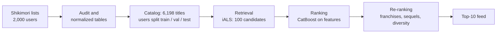

# Shikimori anime recommender


-2E7D32)


A personal anime feed for [Shikimori](https://shikimori.one) users: give it the titles someone has finished, get back the next ten worth watching.

It is also a learning project that walks through a real recommender pipeline end to end – data audit, an offline evaluation protocol, candidate retrieval, ranking, re-ranking and serving – and checks every step with numbers rather than intuition.

## Results

Offline, on 173 held-out users the models never saw during training. For each of them 20% of finished titles are hidden – never a title whose sequel they have also finished, so the model has to guess what comes next rather than fill a gap inside a franchise. The question is whether it brings the hidden titles back.

| Model | Recall@100 (retrieval) | NDCG@10 | Catalog coverage@10 |
| --- | --- | ---: | ---: |
| Popularity | 0.327 [0.295–0.360] | 0.229 | 1% |
| Item-kNN (co-watching) | 0.417 [0.383–0.450] | 0.295 | 3% |
| PureSVD, k=64 | 0.555 [0.522–0.585] | 0.502 | 7% |
| **iALS, 128 factors** | **0.582 [0.547–0.615]** | 0.484 | 9% |

Brackets are 95% bootstrap intervals over users. Every gap in Recall@100 between neighbouring rows is significant in a paired bootstrap. iALS is the current retrieval model.

**Untouched test users** (173 people none of the choices were made on) confirm every stage: NDCG@10 is 0.225 for popularity, 0.522 for iALS, 0.613 for CatBoost and 0.550 after re-ranking, with catalog coverage@10 0.125 – the success criterion holds on test as well.

**Ranking.** A CatBoost ranker (`YetiRank`) on top of iALS's 100 candidates raises NDCG@10 from 0.484 to 0.590 (+0.106, 95% CI [0.082, 0.129]). Title-level features alone give only +0.024; the gain comes from user–title features, above all franchise links such as "the previous part is finished". Genre match, user profile and favourites add nothing measurable, and neither Optuna tuning nor a seed ensemble helps.

**Re-ranking.** Product rules on top of the ranker: never show a sequel before its prequel is finished, at most one title per franchise, and a popularity penalty. The first two cost nothing measurable; the penalty buys catalog coverage@10 from 8% to 12% (the success criterion: 10× popularity) for NDCG@10 0.590 → 0.516, still above the iALS order. The ranker's feed had a sequel without its prequel in 4% of slots and repeated franchises in 9%; after re-ranking, none.

**Simulated A/B against popularity.** The 173 test users open the feed ten times. A user looks at position *i* with probability 1/log2(*i* + 1) and finishes a title only if it is one of their hidden titles; a finished title joins the history, so the next feed changes, and a title shown twice without a finish is not shown again. The full pipeline gets 11.8 finishes per user against 6.2 for a popularity feed with the same product rules, and shows 31% of the catalog against 6%. Split into two halves like a real A/B test (87 and 86 users) the difference is +6.3 [+3.9, +8.5]; with every user seeing both feeds, which only a simulation allows, it is +5.6 [+4.8, +6.5]. The user model is an assumption, not a measurement: only the hidden titles count as wanted, everything else as not.

## What the data taught us

- **A zero score is not a dislike.** 67% of list entries have `score = 0`: people simply don't rate. The positive label is "finished the title", and ratings are kept as a separate signal.
- **Timestamps can't be trusted as viewing dates.** Lists are often filled in bulk. On 122k prequel–sequel pairs the sequel was added *before* the prequel 15% of the time, and within the same minute 41% of the time. So there is no time-based split; users are split into train / validation / test groups instead.
- **Popularity is a strong baseline and a bad feed.** It finds something relevant in the top 10 for 71% of users, but shows everyone the same ~70 titles.
- **A few heavy users would dominate the model.** The top 1% of users produce 35% of all co-watched pairs, so every user's influence is down-weighted by the size of their list.
- **Random hiding creates easy answers.** If any 20% of a user's titles can be hidden, about a third of the hidden ones are gaps inside a franchise (seasons 1 and 3 seen, season 2 hidden), and franchise features find them almost for free. So a title is hidden only if the user hasn't finished its sequel.
- **Leakage is easy to miss.** When the retrieval model has seen a user's hidden titles, Recall@100 jumps from 0.497 to 0.590. The ranking dataset is therefore built with a 5-fold split over users, and each fold is scored by a model trained without it.

## How it works



- **Catalog.** TV series, films, OVA/ONA and specials with at least 5 completions among training users. Music videos, ads and promos are excluded.
- **Retrieval** narrows 6,198 titles to 100 candidates per user. Its metric is Recall@100.
- **Ranking** reorders those 100 with features of the title, the user and the pair (genre match, popularity, whether the prequel is finished). Its metric is NDCG@10.
- **Re-ranking** applies product rules: no sequel before its prequel, a cap on titles from one franchise, more variety.
- **Serving** loads exported model files and builds a feed for any history without retraining.

## Data

A snapshot of 2,000 active Shikimori users collected on 2026-09-24 with a modified version of [kdduha/shikimori-parse](https://github.com/kdduha/shikimori-parse): 694,673 list entries, 1.7M list events, 21k favourites, and a catalog of 30,133 titles with genres, studios and franchise links. The data is not published: it contains site user IDs and needs a privacy review first. The schema is in [docs/dataset_design.md](docs/dataset_design.md).

## Quick start

```bash
uv sync                                                    # installs core, serving, training and notebook tools
uv run python -m training.ingestion.build_dataset     # raw snapshots in data/raw -> normalized tables
uv run python -m training.interactions.prepare        # catalog, labels, user split
uv run python -m training.retrieval.als               # compare retrieval models on validation
uv run python -m training.pipelines.export_models     # train the final iALS, save to models/
```

```python
from serving.recommender import Recommender

feed = Recommender.load().recommend(history=[1, 205, 30, 47, 43], k=5)
for item in feed:
    print(item.russian or item.name)
```

For the history *Cowboy Bebop, Samurai Champloo, Evangelion, Akira, Ghost in the Shell* this returns *The End of Evangelion*, *Cowboy Bebop: The Movie*, *Great Teacher Onizuka*, *Perfect Blue*, *Paprika*.

For production, install only the serving package: `uv sync --package serving --no-dev`.

## Run the API

```bash
uv run python -m training.pipelines.export_models   # once: writes models/als_v0
docker compose up --build                            # backend on http://localhost:8000
```

```bash
curl -X POST localhost:8000/feed -H "Content-Type: application/json" -d '{"history": [1, 205, 30, 47, 43], "k": 5}'
```

The backend image contains only `core` and `serving`; model files are mounted from `models/`, so retraining needs a container restart, not a rebuild. The frontend is static HTML and JavaScript behind nginx; the history lives in the browser. Without Docker: `uv run uvicorn serving.api:app` and `uv run python -m http.server 3000 --directory frontend`.

## Repository

```
backend/          the Python side: one uv workspace (pyproject.toml, uv.lock, Dockerfile)
  core/           shared kernel: paths, catalog rules, anime features
  serving/        Recommender (iALS -> CatBoost -> rules) and the FastAPI app
  training/       everything offline
    ingestion/      raw snapshots -> normalized tables
    interactions/   labels, user split, evaluation data
    evaluation/     metrics, evaluation loop, bootstrap
    retrieval/      popularity, item-kNN, PureSVD, iALS
    ranking/        leak-free candidate dataset, CatBoost ranker
    reranking/      evaluation of the feed rules
    simulation/     feedback loop and simulated A/B test
    pipelines/      final test, train final models and export them for serving
  notebooks/      audit, baselines, item-kNN, retrieval comparison, ranking, re-ranking, test, simulation
  experiments/    index of experiments with key metrics
  data/, models/  local data and model artifacts (not in Git)
frontend/         static web feed (nginx)
docs/             system design, dataset schema, recsys playbook
```

Three packages in one uv workspace. `serving` depends only on `core`, so a production image contains no training code or training libraries.

The notebooks hold the reasoning behind each decision; [experiments/README.md](experiments/README.md) lists every experiment with its numbers.

## Roadmap

- [x] Data audit and evaluation protocol
- [x] Baselines: random, popularity
- [x] Retrieval: item-kNN, PureSVD, iALS, compared with confidence intervals
- [x] Leak-free dataset for ranking
- [x] Ranking with CatBoost: title features, Optuna tuning
- [x] Ranking: user–title features (franchise, genres, profile, favourites)
- [x] Re-ranking: franchises, sequel order, popularity penalty
- [x] One-time check on the untouched test users
- [x] Feedback-loop simulation and a simulated A/B test against popularity
- [x] FastAPI service and a small web feed

## Limitations

All numbers are offline proxies: there are no impression or click logs, so "the user finished a hidden title" stands in for "the user would like the recommendation". Validation has 173 users, and model settings were chosen on it; the test group stays untouched until the final pipeline is fixed. The cohort is active users only and doesn't represent all of Shikimori.
