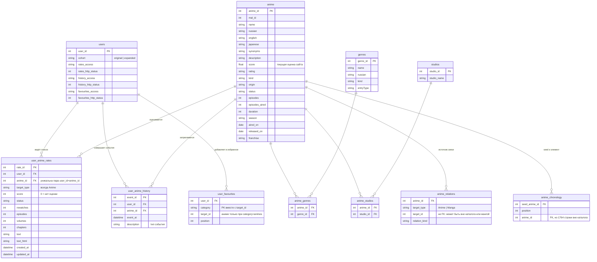

# Структура датасета Shikimori v1

Состояние: схема проверена и реализована в `packages/training/src/training/ingestion/build_dataset.py`; результат находится в `data/processed/shikimori_v1/`. Это таблицы исходных фактов для анализа, а не уже очищенный обучающий набор. Папки `data/raw/` остаются неизменными. При построении таблиц не заполняем пропуски, не превращаем `score=0` в отрицательную оценку и не удаляем подозрительные записи без отдельного решения в data audit.

Команда из корня проекта: `uv run python -m training.ingestion.build_dataset`. Скрипт создаёт 11 CSV и `manifest.json` только если выходной каталог ещё не существует; готовые данные не перезаписывает. `manifest.json` содержит число строк и SHA-256 входных файлов.

## Какие снимки входят

- Когорта: 2000 ID, из них исходные 1151 и ещё 849 случайно выбранных с `seed=42` из списка активных пользователей Shikimori. В текущем списке аниме записи есть у 1996 пользователей.
- Текущий список: только `shikimori_expanded_users_2000_2026-09-24/users_rates.csv`, 694 673 строк. Старый `shikimori_all_status_history_2026-09-24/users_rates.csv` — предыдущий снимок тех же исходных пользователей. Его не прибавляем к текущему списку, но оставляем в `raw` для проверки происхождения и изменений.
- История: объединение двух `users_history.csv`: 246 830 событий исходной группы и 1 486 517 событий новой группы. Группы пользователей не пересекаются; всего 1 733 347 событий. История — события изменения списка, текущий список — последнее состояние пары пользователь–аниме. Одинаковые `user_id` и `anime_id` в этих таблицах не являются дубликатом.
- Избранное: 21 010 записей всех категорий. В том числе 5990 избранных аниме; остальные категории сохраняем для анализа.
- Каталог: 30 133 аниме, а также отдельные таблицы жанров, студий, связей и хронологии.

## Канонические таблицы

Текущая реализация сохраняет CSV. В будущем те же таблицы можно перевести в Parquet для публикации. Каждая таблица хранит один тип факта, без повторения полей аниме в пользовательских записях и без заранее соединённой «общей» таблицы.

| Таблица | Строки | Ключ и содержание | Источник |
| --- | ---: | --- | --- |
| `users` | 2000 | `user_id` — ключ; принадлежность к исходной/добавленной группе и доступность rates, history, favourites. Доступная, но пустая история отличается от недоступной. | `cohort_manifest.json`, `*_access.csv` |
| `user_anime_rates` | 694 673 | `rate_id` — ключ; уникальная пара (`user_id`, `anime_id`); `score`, `status`, `episodes`, `rewatches`, `volumes`, `chapters`, `text`, `text_html`, `created_at`, `updated_at`, `target_type`. `target_id` переименован в `anime_id`. | расширенный `users_rates.csv` |
| `user_anime_history` | 1 733 347 | `event_id` — ключ; `user_id`, `anime_id`, `event_at`, `description`. Для одной пары допустимо много событий. `id` переименован в `event_id`, `created_at` — в `event_at`. | оба `users_history.csv` |
| `user_favourites` | 21 010 | (`user_id`, `category`, `target_id`) — проверяемая уникальная тройка; `position`. `target_id` означает аниме только при `category='animes'`. | `user_favourites.csv` |
| `anime` | 30 133 | `anime_id` — ключ; все исходные поля каталога: названия, описание, формат, статус, серии, даты, оценка сайта, франшиза и т. д. `id` переименован в `anime_id`. | `anime.csv` |
| `genres` | 80 | `genre_id` — ключ; названия и тип жанра. | `genres.csv` |
| `anime_genres` | 80 265 | Связь (`anime_id`, `genre_id`); название жанра здесь не повторяется. | `anime_genres.csv` |
| `studios` | 1571 | `studio_id` — ключ, `studio_name`. Для каждого ID в выгрузке найдено ровно одно название. | уникальные (`studio_id`, `studio_name`) из `anime_studios.csv` |
| `anime_studios` | 21 128 | Связь (`anime_id`, `studio_id`); название студии здесь не повторяется. | `anime_studios.csv` |
| `anime_relations` | 40 285 | Ребро (`anime_id`, `target_type`, `target_id`, `relation_kind`). `target_type` обязателен: 8849 целей — Manga, а не Anime. | `anime_relations.csv` |
| `anime_chronology` | 50 439 | Элемент последовательности (`seed_anime_id`, `position`, `anime_id`). Это порядок ответа API для франшизы; он не доказан как порядок просмотра. | `anime_chronology.csv` |

Таблица `users` сохраняет информацию о доступности: у 27 исходных пользователей история недоступна, а у некоторых доступна, но не содержит событий. Отсутствие строк истории нельзя автоматически трактовать как отсутствие действий.

`anime_relations` и `anime_chronology` не сливаем между собой: первая таблица описывает тип связи между объектами, вторая — позицию в полученной последовательности. `anime_relations` содержит 91 ребро к аниме вне каталога, `anime_chronology` — 1764 строки с `anime_id` вне каталога. Оставляем эти строки для аудита. Пять полностью одинаковых строк `anime_relations` также сначала фиксируем, а решение об устранении принимаем в отдельном наборе для моделирования.

Поле `franchise` из сырой хронологии не дублируем в структурированной таблице: во всех 50 439 строках оно совпадает с `anime.franchise` у `seed_anime_id`, поэтому доступно через соединение. Исходное поле остаётся в `raw` для повторной проверки.

## Схема связей (ER-диаграмма)

Построена по заголовкам CSV в `data/processed/shikimori_v1/` и по проверкам из `build_dataset.py`. CSV не хранит ограничений, поэтому внешние ключи ниже проверяются скриптом сборки, а не базой данных.

Как читать: таблицы-связки `anime_genres` и `anime_studios` разворачивают отношение «многие ко многим». `user_favourites.target_id` и `anime_relations.target_id` полиморфны (аниме, манга, персонажи и т. д.), поэтому настоящими внешними ключами они не являются. `franchise` лежит в `anime` и группирует аниме в серии; отдельной таблицы франшиз нет.

## Правила построения и проверки

1. Сохранить исходные CSV/JSON и манифесты в `data/raw/`. Структурированные таблицы строить воспроизводимо в новой версии `data/processed/`; не редактировать сырые файлы на месте.
2. Привести названия ключей и временных полей, но сохранить исходные значения, пропуски и текст для проверки. В CSV даты остаются исходными ISO-строками. При чтении в ноутбуке парсить их как UTC с `format='mixed'`: обычное `pd.to_datetime(..., utc=True)` ошибочно даёт 3020 пропусков для двух допустимых форматов `created_at` в списке; с `format='mixed'` пропусков нет.
3. Проверить уникальность ключей и соответствие внешних ключей. Все 694 673 текущих записей и все ID аниме из истории находятся в каталоге. У текущих записей нет повторов пары пользователь–аниме и `rate_id`; у объединённой истории нет повторов `event_id`.
4. Отдельно показать пропуски и распределения. В текущем списке `score=0` у 469 152 строк — это отсутствие явной оценки. В каталоге отсутствует `description` у 15 287 аниме, `season` у 21 224. Не заполнять их до анализа задачи.
5. Отдельно проверить длинные истории: медиана 150 аниме на пользователя, максимум 28 904, семь пользователей имеют более 5000 записей. Такие профили могут повлиять на статистику; исключение решать после просмотра, не при сборке таблиц.
6. Не создавать в каноническом слое `label`, «негативы», train/test или заранее соединённый `interactions_plus_anime`. Это производные представления для конкретного эксперимента. Отсутствующая пара пользователь–аниме означает неизвестное отношение.

## Время и будущая оценка модели

`user_anime_rates.created_at` — создание записи в списке, `updated_at` — последнее изменение записи; ни одно поле само по себе не является датой окончания просмотра. `user_anime_history.event_at` — время действия на сайте. Даже событие «Просмотрено» показывает изменение статуса списка, а не подтверждённый момент фактического просмотра. Текущие `anime.score`, `status`, `episodes_aired`, избранное и финальные оценки нельзя подавать в признаки для рекомендации в прошлом без проверки их доступности на момент рекомендации. Историю событий сначала изучаем в EDA; затем отдельно формулируем протокол временного разбиения.

## Публикация

Схема выше — полная внутренняя версия для data audit. Публичный экспорт следует создавать отдельно из неё, сохранив соответствие таблиц. Не выкладывать исходные `user_id`, пользовательские `text`/`text_html`, точные последовательности событий и тексты/описания без проверки права на распространение и риска идентификации. Простая замена ID на хеш не гарантирует анонимности: историю можно сопоставить с публичным профилем. Для публикации нужна документированная версия, источник и дата каждого снимка, способ отбора пользователей, словарь полей, числа строк, известные пропуски и ограничения; лицензию нельзя назначать исходным данным произвольно. Когорта состоит из активных пользователей и не представляет всех пользователей сайта.

Предпочтительный формат публичных таблиц — Parquet; Hugging Face поддерживает и Parquet, и CSV, а Parquet рекомендует для типизированных табличных наборов. Текстовое описание набора и его ограничений должно войти в Dataset Card. Выпуск публичной версии — отдельный шаг после data audit и проверки возможности повторного распространения данных.

Источники по публикации: [форматы и Dataset Card Hugging Face](https://huggingface.co/docs/hub/datasets-adding), [политика Hugging Face о приватности и интеллектуальных правах](https://huggingface.co/content-policy).
